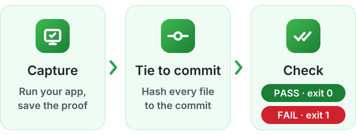
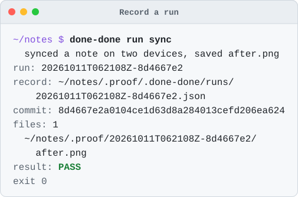
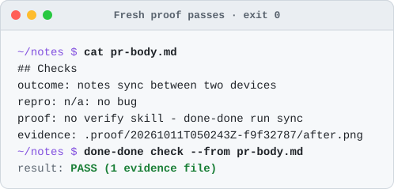
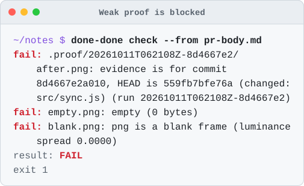
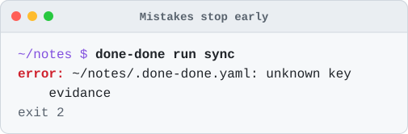

<div align="center">

<picture>
  <source media="(prefers-color-scheme: dark)" srcset="docs/media/wordmark-dark.svg">
  
</picture>

### No proof, no "done".

done-done won't accept "done" without real, fresh proof from your product, captured at the exact commit being called done.

[](https://nodejs.org) [](#whats-next) [](https://www.npmjs.com/package/done-done-axi)

<br>

<picture>
  <source media="(prefers-color-scheme: dark)" srcset="docs/media/flow-dark.svg">
  
</picture>

<br><br>

<picture>
  <source media="(prefers-color-scheme: dark)" srcset="docs/media/hero-dark.svg">
  
</picture>

</div>

## Why

"Done" is easy to say. Screenshots get reused, recordings go stale, and a green test run is not the app.

done-done runs your capture and ties every screenshot, recording and log it saves to the exact commit. When someone says "done", it checks the proof they point to: is it really there, is it a real picture or video, is it from this commit, and is it new? If not, the check fails. If it can't tell, it says so instead of passing.

## See it work

Four moments from a demo notes app. Every picture is real output from the current build.

<picture><source media="(prefers-color-scheme: dark)" srcset="docs/media/run-dark.svg"></picture>
<picture><source media="(prefers-color-scheme: dark)" srcset="docs/media/pass-dark.svg"></picture>

<picture><source media="(prefers-color-scheme: dark)" srcset="docs/media/reasons-dark.svg"></picture>
<picture><source media="(prefers-color-scheme: dark)" srcset="docs/media/config-dark.svg"></picture>

done-done is an [AXI](https://axi.md), which means -

- It's just a CLI any capable agent can run without setup.
- It's built for agents: [TOON](https://github.com/toon-format/spec) output by default (`--json` and `--full` when needed), and every result names the next command in its `help` lines.
- The skill below only handles discovery; agents learn done-done by using it.

## Use It From Your Agent

You need Node 22.5 or later and git. Give your agent the done-done skill in the [Agent Skills](https://agentskills.io) format with [`npx skills`](https://github.com/vercel-labs/skills), naming your agent with `-a`:

```sh
npx skills add umeranjum17/done-done-axi --skill done-done -a claude-code -y
```

Use `-a codex` or `-a opencode` for those agents. `-a` and `-y` skip the installer's four prompts and keep it from writing skill folders for agents you do not use.

The skill lands in this project (`.claude/skills/done-done/` for Claude Code, `.agents/skills/done-done/` for Codex and opencode) next to a `skills-lock.json`: commit both so teammates and CI get it too. Or add `-g` to install it once for all your projects (`~/.claude/skills/` for Claude Code) and leave the project untouched.

That is the entire setup - no npm install needed.
The skill tells your agent to use `done-done` if it is on PATH and otherwise run the GitHub package through `npx`, so the CLI comes along on demand:

```sh
npx -y --allow-git=all github:umeranjum17/done-done-axi --help
```

The skill stays a short stub and sends the agent to `--help` and the bare command for current instructions, so an installed copy cannot go stale against a newer CLI.

Then, in agents that expose skills as slash commands (Claude Code, for example), invoke it directly:

```
/done-done prove the app in this repo works
```

Or just ask in plain words - "prove the app in this repo works", "is this really done?", "gate this PR on proof" - and the agent loads the skill on its own.

## Other Ways to Use done-done

The skill is the recommended path, but it is not the only one.

### Manual CLI

**1. Install**

```sh
npm install -g --prefix ~/.local --allow-git=all github:umeranjum17/done-done-axi
```

`--prefix ~/.local` installs into your home folder, so it needs no `sudo`. `--allow-git=all` is needed on npm 12, which blocks GitHub installs by default (verified accepted on npm 10). This installs two names for the same CLI: `done-done-axi` and the short `done-done` used below. If `command -v done-done` prints nothing, add `~/.local/bin` to your `PATH`: `export PATH="$HOME/.local/bin:$PATH"`.

To skip the install, run `npx -y --allow-git=all github:umeranjum17/done-done-axi` wherever this README says `done-done`.

Once done-done-axi is published to npm, the registry line takes over as the install:

```sh
npm install -g --prefix ~/.local done-done-axi
```

<!-- TODO(dd-npm-name): when done-done-axi is published to npm, flip the primary back to the registry line above and make `npx -y done-done-axi` the skip-the-install path. -->

**2. Set it up in your app's repo**

```sh
cd your-app
done-done init
```

`init` writes a minimal `.done-done.yaml` (only if you don't already have one) that names your app. A plain `init` never overwrites an existing config. It also scaffolds a verify skill at `.agents/skills/verify-<app>` from the repo's own files, for your agent to finish with one live drive. Evidence lives outside the repo, in `~/.done-done/evidence/<app>`, so it outlives the checkout that captured it. Then describe how to capture proof — swap the command for whatever drives your real app and saves screenshots, recordings or logs:

```yaml
journeys:
  smoke:
    command: npm test > $DONE_DONE_EVIDENCE_ROOT/${RUN_ID}.log
```

The command runs from the repo root with `DONE_DONE_EVIDENCE_ROOT` (a new folder for this run in the evidence root) and `DONE_DONE_RUN_ID` set, and `${RUN_ID}` in it is replaced. A run that writes nothing into its folder fails.

Optional: `done-done init --agent claude` adds a Claude Code SessionStart hook to the repo's `.claude/settings.json` that shows each session the bare `done-done` state, `done-done init --agent codex` adds the same SessionStart hook to the repo's `.codex/hooks.json` for Codex, and `done-done init --agent opencode` adds a plugin to the repo's `.opencode/plugins/` that adds the state to the first message of each opencode session. See the [reference](docs/reference.md#set-up-a-repo).

Record the recipe in the repo so anyone can re-run the proof, then commit it (and `.claude/settings.json`, `.codex/hooks.json`, or `.opencode/plugins/done-done.js` if you added a hook):

```sh
done-done init --journey smoke -- 'npm test > $DONE_DONE_EVIDENCE_ROOT/${RUN_ID}.log'
git add .done-done.yaml
git commit -m "Add done-done"
```

A `run -- <command>` whose command matches no recorded journey still runs, but its result hints that the recipe is not in the repo.

**3. Run it, then check it**

```sh
done-done run smoke
done-done check --outcome "it starts" ~/.done-done/evidence/your-app/*/*.log
```

Each command prints one machine-readable result. By default it is [TOON](https://github.com/toon-format/spec) (the compact AXI convention), and a passing check shows `result: pass`. Add `--json` for JSON, or `--full` to list every evidence file or finding instead of the first few. After later runs, use the `run_id` the result prints in place of the first `*`.

When a check passes, save a receipt and re-verify it later:

```sh
done-done receipt --outcome "it starts" ~/.done-done/evidence/your-app/*/*.log
done-done receipt --verify "$(git rev-parse HEAD)"
```

Run `done-done` with no arguments to see the current config and the next step.

## What it checks

- 🔗 **Tied to a commit**: Every run records the commit, and whether there were uncommitted changes.
- 🖼️ **Real media**: Empty, cut-off, blank or tiny screenshots fail. Videos must hold real frames (needs `ffprobe`).
- ⏱️ **Fresh**: Proof from an older commit fails. Commits that only touch docs can be set to keep it fresh.
- ♻️ **Not reused**: Proof made only of files already used for a different claim fails, and so does citing the same file twice. A claim is named by `--claim-id <id>`, which defaults to your branch, so rewording it keeps its proof. Several claims on one branch each need their own `--claim-id`.
- 🧾 **Honest claims**: Reads a pull request's `## Checks` block — from a file, a URL, or stdin — and makes sure every line is filled in.
- 📌 **Verifiable later**: `receipt` records a passing check against the exact commit and the sha256 of every file it cited; `receipt --verify` re-checks it from any checkout of that commit on the same machine (a merge gate or a fresh clone), or in CI once the evidence folder is copied there ([how](docs/reference.md#where-proof-lives)).
- 👀 **Shows the outcome** (opt-in): `--judge` asks a model on your own Claude plan whether each screenshot is the right screen for the claim (cheap Haiku by default; set `judge.model` for another); a wrong screen fails.
- 🔒 **Safe in CI**: `--trusted-ref origin/main` reads the rules from your main branch, so a pull request can't loosen them.

Every answer is an exit code: **0** pass, **1** fail, **2** usage or config error, **3** can't tell either way.

## Use with Firstmate or another agent fleet

[Firstmate](https://github.com/kunchenguid/firstmate) hands tasks to agent workers and merges their work. done-done ships what those workers need to prove each task, and what the merge needs to check that proof, in [`integrations/firstmate/`](integrations/firstmate/).

Install the skill once per machine for your workers' agent (`-a codex` or `-a opencode` for those), install the CLI from GitHub, and copy two files from it into your Firstmate home:

```sh
npx skills add umeranjum17/done-done-axi --skill done-done -g -a claude-code -y
npm install -g --allow-git=all github:umeranjum17/done-done-axi
cat "$(npm root -g)/done-done-axi/integrations/firstmate/brief-include.md" >> "$FM_HOME/config/brief-include.md"
cp "$(npm root -g)/done-done-axi/integrations/firstmate/merge-gate" "$FM_HOME/config/merge-gate"
```

- **`brief-include.md`**: Firstmate adds `config/brief-include.md` to every worker brief. It tells the worker to set up done-done, run a journey on its committed change, write a `## Checks` block, pass `check`, and record a `receipt`. The evidence and receipt stay in `~/.done-done/evidence/<app>` after teardown deletes the worktree.
- **`merge-gate`** (optional): `merge-gate <task-id> <worktree|-> <head> <pr-url|->`. In the worktree, it refuses a PR whose head is not `<head>`, then runs `done-done check --from <PR URL or $FM_HOME/data/<task-id>/checks.md> --trusted-ref <default branch>` (`origin/HEAD`, else `origin/main` or `origin/master`, else the local `main` or `master` in a repo with no remote), then `done-done receipt --verify <head>`. Both paths read done-done's rules from your default branch, never from the task's own branch, so merge `.done-done.yaml` there before you rely on it. The gate does not fetch: it reads the local `origin` refs, so run `git fetch origin` before you run it. It needs `done-done` on PATH (the `npm install` line above). A nonzero exit refuses the merge, and done-done's output says why. A worktree of `-` means the task recorded none: the gate does not cd and runs git and done-done in the current directory (the caller's project clone). Upstream Firstmate does not call a merge gate yet, so this file has no effect until it does; you can run it by hand before a merge.

Another fleet works the same way: add the include text to whatever your workers read first, and run `merge-gate` before each merge, with `FM_HOME` set to the folder that holds `data/<task-id>/checks.md` for local-only tasks.

## Learn more

- [Full reference](docs/reference.md): every `init`, `run`, `check` and `receipt` option, the Checks block rules, each file check, and both config files.
- [Report a problem or ask a question](https://github.com/umeranjum17/done-done-axi/issues)

## What's next

So far: `init`, `run`, `check`, `receipt`, the opt-in screenshot judge and the opt-in Claude Code, Codex and opencode session hooks. Coming next: help writing the proof steps for your app.

## Develop

```sh
git clone https://github.com/umeranjum17/done-done-axi
cd done-done-axi
npm install
npm install -g --prefix ~/.local .   # optional: links this checkout as done-done on your PATH
npm test   # builds, then runs the end-to-end tests against throwaway git repos
npm run build:skill              # regenerate skills/done-done/SKILL.md from src/skill.ts
npm run build:skill -- --check   # fail if the committed skill is out of date (CI runs this)
```

To try an unreleased commit without cloning, run it straight from GitHub (npm 12 needs `--allow-git=all`):

```sh
npx -y --allow-git=all github:umeranjum17/done-done-axi --help
```

`dist/` is committed, so installing from GitHub needs no build step. `npm test` rebuilds it and fails while the rebuilt `dist/` differs from the commit or has files git does not track, so `git add` the new `dist/` files with your change.

The terminal pictures (hero, run, pass, reasons, config) are real output from the current build; redraw them with `npx tsc && node docs/media/make.mjs`. The wordmark and the flow picture are hand-made SVGs.
